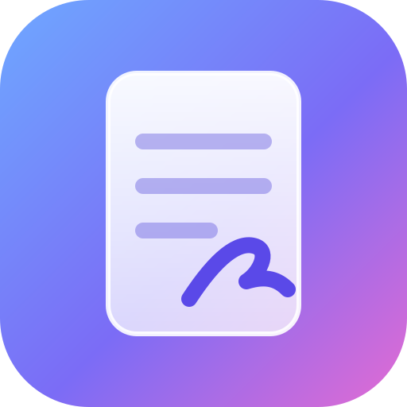
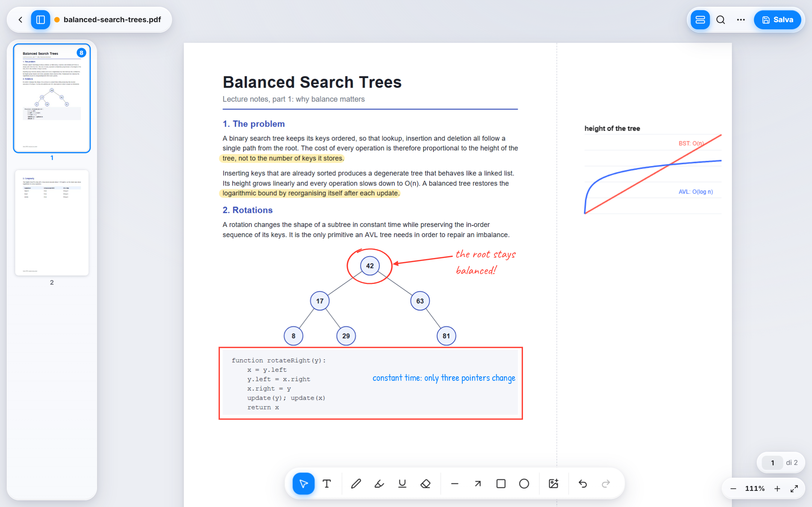
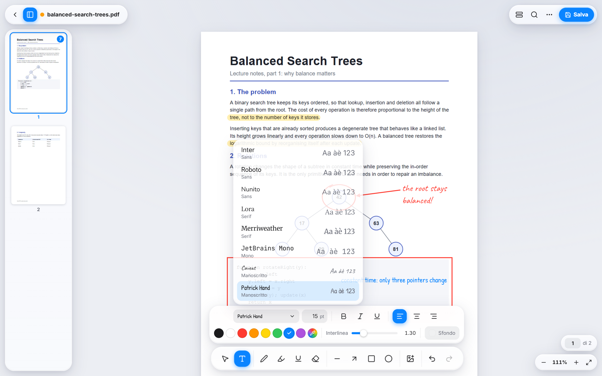
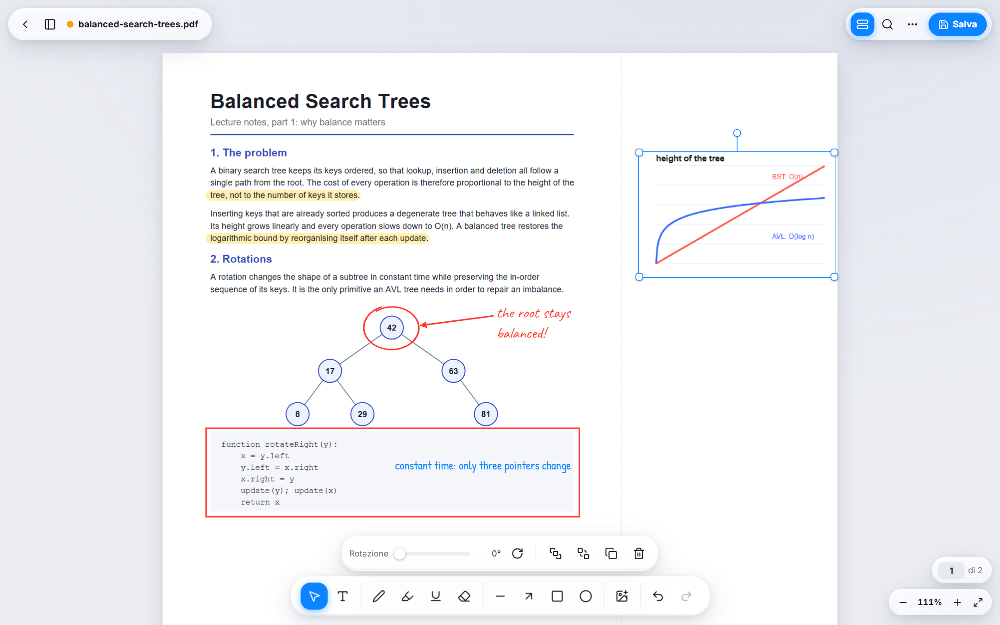
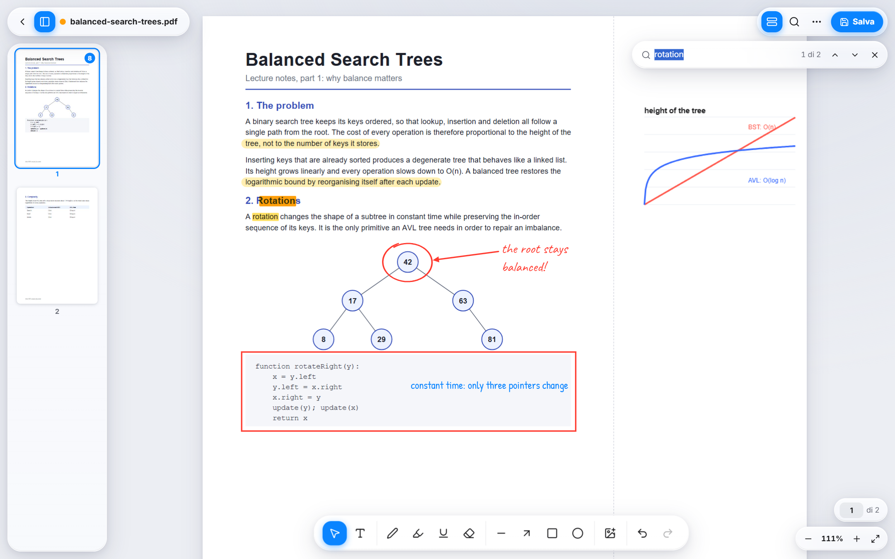
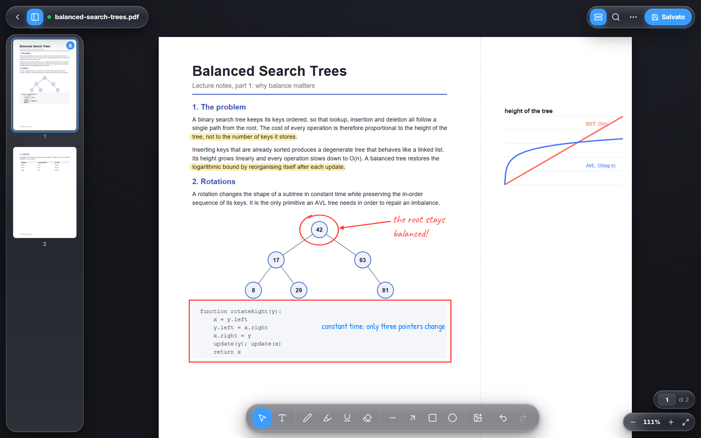
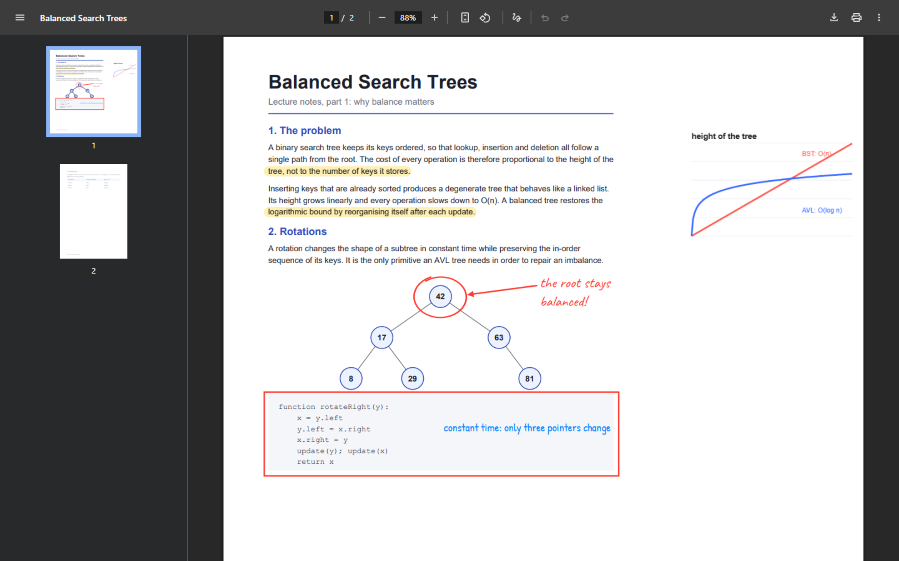

<div align="center">



# Vetro PDF

**Annota qualsiasi PDF, premi Ctrl+S e mantieni ogni annotazione modificabile per sempre.**

[Demo online](https://alenhenjas.github.io/vetro-pdf/) · [Architettura](docs/ARCHITECTURE.md) · [Formato PDF](docs/PDF-FORMAT.md) · [English](README.md)

</div>



Vetro PDF è una PWA desktop local-first che scrive direttamente sul file originale. I documenti salvati si aprono correttamente in qualsiasi lettore PDF e, riaperti in Vetro, tornano oggetti modificabili anziché pixel.

## Perché esiste

Molti strumenti PDF nel browser caricano il file su un server, appiattiscono le modifiche o esportano una nuova copia. Vetro PDF no:

- **Il file resta sul tuo computer.** Non c'è un server e in produzione una Content Security Policy blocca ogni connessione esterna.
- **Salvare significa salvare.** Ctrl+S sovrascrive l'originale tramite la File System Access API.
- **Le annotazioni restano modificabili.** Tratti, forme, testi e immagini si possono spostare, cambiare o eliminare anche dopo la riapertura.
- **Il risultato è un PDF normale.** Le annotazioni sono contenuto vettoriale con subset dei font incorporati, quindi Chrome, Edge e gli altri lettori le mostrano senza plugin.

## Funzionalità

- **Testo:** caselle spostabili e ridimensionabili, 8 font inclusi con anteprima, dimensione, colore, grassetto, corsivo, sottolineato, allineamento, interlinea, sfondo con opacità.
- **Disegno:** penna sensibile a velocità e pressione, evidenziatore che non copre il testo, gomma per oggetto, linea, freccia, rettangolo, ellisse, sottolineatura dritta agganciata al testo del PDF.
- **Immagini:** incolla, trascina o inserisci alla risoluzione originale, ridimensiona in proporzione, ruota. *Allarga margine* aggiunge spazio a destra della pagina.
- **Modifica:** selezione multipla, maniglie, duplica, ordine di sovrapposizione, copia e incolla tra pagine, annulla e ripeti illimitati.
- **Navigazione:** miniature e pagine virtualizzate, zoom con Ctrl+rotella e pinch, adatta larghezza, ricerca nel testo.
- **Sicurezza:** indicatore delle modifiche, bozze automatiche con ripristino dopo un crash, copia dell'originale prima della prima sovrascrittura, avviso se un altro programma ha cambiato il file.
- **Desktop:** PWA installabile, funzionamento offline, gestore dei PDF per «Apri con», file recenti.

<table>
<tr>
<td></td>
<td></td>
</tr>
<tr>
<td></td>
<td></td>
</tr>
</table>

## Il file salvato è un vero PDF

Lo stesso documento aperto nel lettore integrato di Chrome:



## Avvio

Prova la [demo online](https://alenhenjas.github.io/vetro-pdf/) in Chrome o Edge, poi scegli **Installa** nella barra degli indirizzi per avere un'app autonoma che funziona anche offline.

In locale, con Node.js 24:

```bash
git clone https://github.com/alenhenjas/vetro-pdf.git
cd vetro-pdf
npm install
npm run dev
```

| Comando | Scopo |
| --- | --- |
| `npm run dev` | Server di sviluppo su http://localhost:5173 |
| `npm run build` | Controllo dei tipi e build di produzione |
| `npm run preview` | Serve la build su http://localhost:4173 |
| `npm test` | Build e test Playwright (richiede Google Chrome) |

## Scorciatoie

| Tasto | Azione | Tasto | Azione |
| --- | --- | --- | --- |
| `V` | Selezione | `Ctrl+S` | Salva sull'originale |
| `T` | Testo | `Ctrl+Maiusc+S` | Salva con nome |
| `P` | Penna | `Ctrl+O` | Apri |
| `H` | Evidenziatore | `Ctrl+Z` / `Ctrl+Y` | Annulla / ripeti |
| `E` | Gomma | `Ctrl+C` / `X` / `V` | Copia / taglia / incolla |
| `R` | Rettangolo | `Ctrl+D` | Duplica |
| `O` | Ellisse | `Ctrl+A` | Seleziona tutto nella pagina |
| `A` | Freccia | `Ctrl+F` | Cerca |
| `L` | Linea | `Ctrl` `+` / `-` / `0` | Zoom, adatta larghezza |
| `U` | Sottolineatura | `]` / `[` | Porta avanti / indietro |
| `Esc` | Deseleziona | `Canc` | Elimina |

## Test

La suite contiene 21 test end-to-end Playwright eseguiti sulla build di produzione in Chrome. Lo scenario principale apre un PDF, aggiunge testo, tratti, forme e un'immagine incollata, salva, riapre, modifica e salva di nuovo. Verifica che gli oggetti restino modificabili, che nulla si duplichi e che il file sia valido e leggibile da pdf.js.

## Limiti noti

- I PDF protetti da password non si possono aprire.
- Il salvataggio riscrive il file, quindi le firme digitali esistenti diventano non valide.
- La formattazione del testo vale per l'intera casella; il testo giustificato non è supportato.
- I caratteri assenti dai font, come le emoji, diventano `?` nel PDF. L'app lo segnala.
- La sovrascrittura dell'originale richiede un browser Chromium. Negli altri browser il file viene scaricato.

## Licenza

Rilasciato con [licenza MIT](LICENSE). Font e librerie incluse mantengono le proprie licenze, elencate in [THIRD-PARTY-NOTICES.md](THIRD-PARTY-NOTICES.md).

---

<div align="center">

Autore: **[Alen Henjas](https://github.com/alenhenjas)**, studente di Ingegneria Informatica all'Università di Modena e Reggio Emilia

</div>
