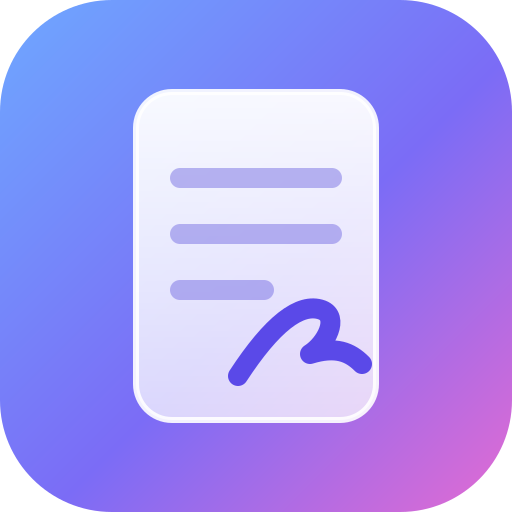
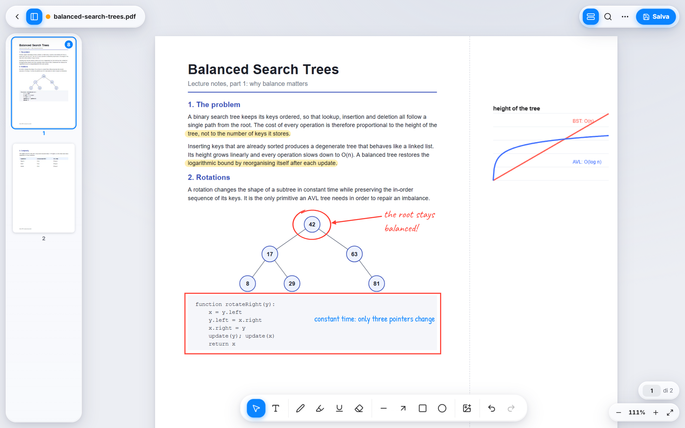
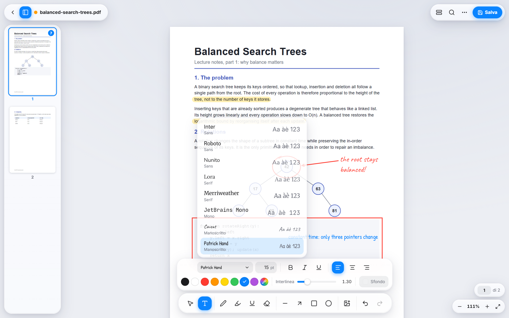
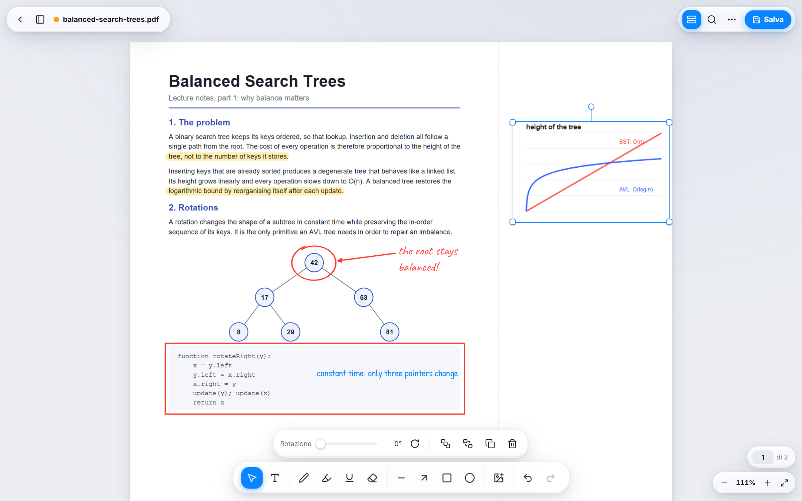
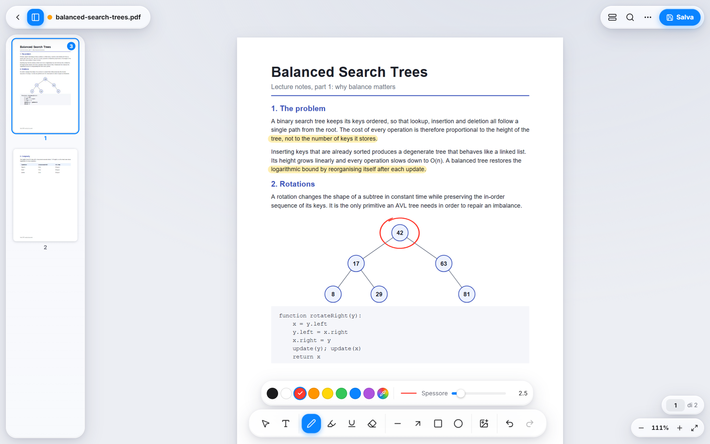
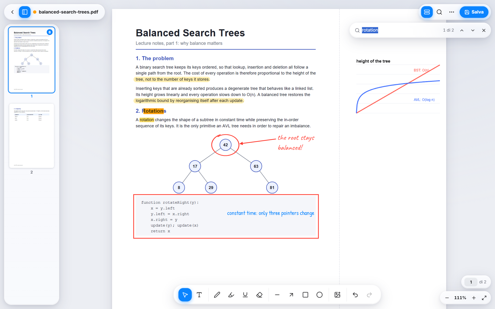
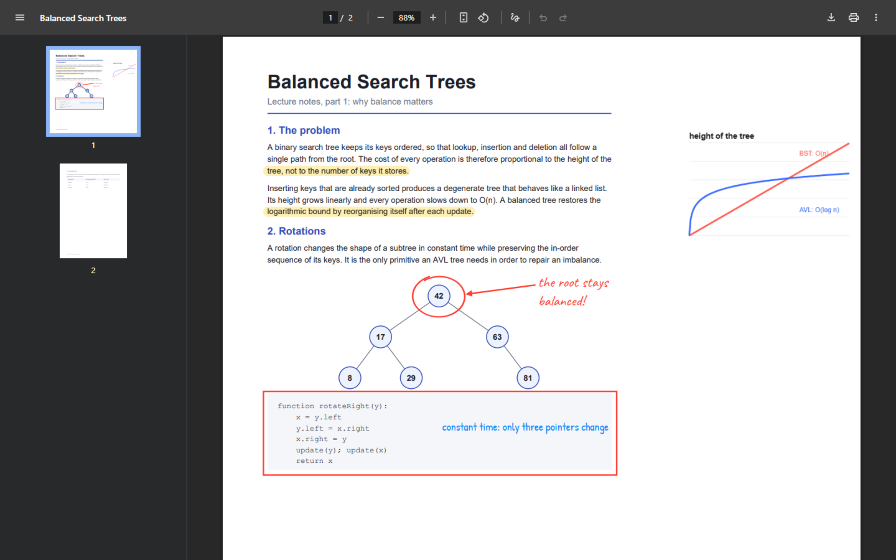
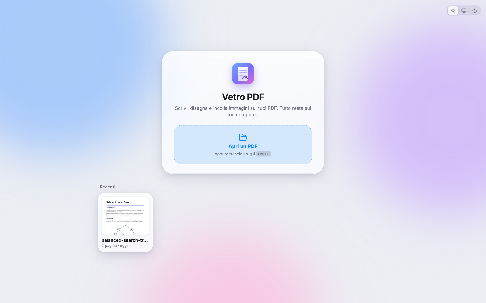
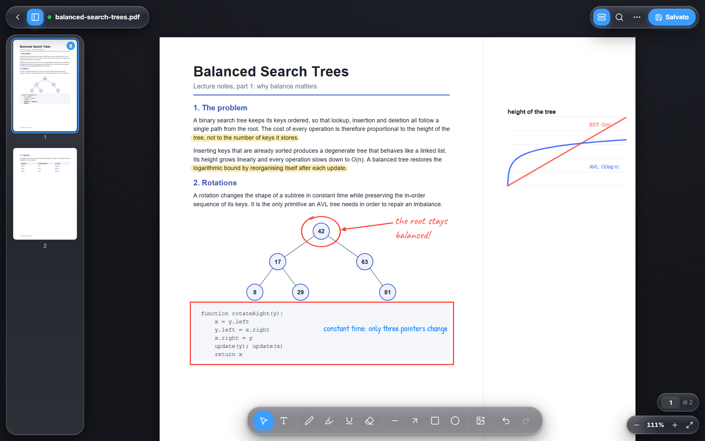
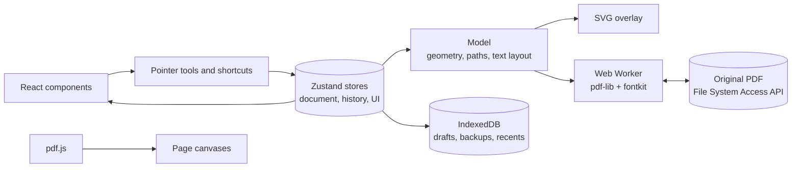

<div align="center">



# Vetro PDF

**Annotate any PDF, press Ctrl+S, and keep every annotation editable forever.**

A local-first desktop PWA that writes directly to the original file. Saved documents open correctly in any PDF reader, and reopen in Vetro as live objects, not flattened pixels.

[Live demo](https://alenhenjas.github.io/vetro-pdf/) · [Architecture](docs/ARCHITECTURE.md) · [PDF format](docs/PDF-FORMAT.md) · [Italiano](README.it.md)

[](https://github.com/alenhenjas/vetro-pdf/actions/workflows/ci.yml)


</div>



## Why it exists

Most browser-based PDF tools upload your file, flatten your edits, or export a new copy. Vetro PDF does none of these:

- **The file stays on your machine.** There is no server. A Content Security Policy blocks every external connection in production.
- **Save means save.** Ctrl+S overwrites the original through the File System Access API.
- **Annotations stay editable.** Reopen a saved PDF and every stroke, shape, text box and image can still be moved, restyled or deleted.
- **The result is a normal PDF.** Annotations are vector content with embedded font subsets, so Chrome, Edge and other readers display them without any plugin.

## Features

<table>
<tr>
<td width="50%"></td>
<td width="50%"></td>
</tr>
<tr>
<td><b>Rich text boxes.</b> Eight bundled fonts with live preview, plus size, colour, bold, italic, underline, alignment, line height and a background with adjustable opacity.</td>
<td><b>Images beside the content.</b> Paste, drop or insert images at full resolution, resize them proportionally and rotate them. <i>Widen margin</i> adds space to the right of the page, so nothing covers the text.</td>
</tr>
<tr>
<td></td>
<td></td>
</tr>
<tr>
<td><b>Natural ink.</b> Smooth, speed-sensitive strokes with stylus pressure support, a multiply highlighter that never hides the text, shapes constrained with Shift, and a straight underline that snaps to the PDF's text.</td>
<td><b>Fast navigation.</b> Virtualised pages and thumbnails, Ctrl+wheel and pinch zoom, fit to width, and accent-insensitive text search across the whole document.</td>
</tr>
</table>

### Everything else

| Area | Details |
| --- | --- |
| **Editing** | Multi-selection, handles, duplicate, bring forward and send back, copy and paste across pages, unlimited undo and redo |
| **Safety** | Unsaved-changes indicator, automatic drafts in IndexedDB with crash recovery, a backup of the original before the first overwrite, and a warning if another program changed the file |
| **Desktop integration** | Installable PWA, offline support, registered as a PDF handler for "Open with", recent files with persistent file handles |
| **Interface** | Liquid-glass design, automatic light and dark themes, contextual panels, custom cursors, tooltips with shortcuts, `prefers-reduced-motion` support. The interface language is Italian |

## The saved file is a real PDF

The same document, saved by Vetro PDF and opened in Chrome's built-in viewer. Layout, fonts, the highlighter blend and the widened page all match the editor:



## Light and dark

The page always stays white, so the document looks the same in both themes.

<table>
<tr>
<td></td>
<td></td>
</tr>
</table>

## Engineering highlights

**Saving can never duplicate content.** On open, the app removes its own layer and works on the clean document. Every save starts again from that clean state, so repeated saves produce no accumulation by construction. End-to-end tests compare object counts between saves. [Read how the format works.](docs/PDF-FORMAT.md)

**One geometry pipeline for screen and file.** The same code generates the vector paths for the on-screen SVG and for the PDF operators. Text layout is computed once and shared by both renderers, so line breaks and baselines cannot drift apart between the editor and the saved file.

**Coordinates survive rotation and cropping.** Annotations are stored in points, in the page's visual space. On export, a matrix derived from `/Rotate` and the CropBox maps them to PDF user space, so they land in the right place on rotated and cropped pages.

**Multiply blending with a correct stacking order.** CSS blending does not cross an SVG root, which would force every highlight underneath other objects. Annotations are split into consecutive runs of SVG layers instead, which preserves user-defined z-order.

**Editable images without storing them twice.** The image XObject used for display is the only copy in the file. JPEGs are recovered byte for byte, and PNGs are rebuilt losslessly from their decoded pixels and soft mask on reopen.

**A font bug found by testing in a second renderer.** Automated text extraction passed, yet letters were missing in Chrome. The cause was fontkit writing a short `loca` table for fonts with odd-length glyphs, which misaligned the outlines in the subset. A build script now pads the affected fonts, and a test guards the invariant. Fonts with a Reserved Font Name are left untouched to respect their license.

**Responsive with large files.** Parsing and writing run in a Web Worker. Rendering uses a priority queue, an LRU canvas cache and DOM virtualisation: a 320-page document keeps fewer than 12 pages mounted.

## Getting started

Try the [live demo](https://alenhenjas.github.io/vetro-pdf/) in Chrome or Edge, then choose **Install** in the address bar to get a standalone app that also works offline.

To run it locally (Node.js 24):

```bash
git clone https://github.com/alenhenjas/vetro-pdf.git
cd vetro-pdf
npm install
npm run dev
```

| Command | Purpose |
| --- | --- |
| `npm run dev` | Development server at http://localhost:5173 |
| `npm run build` | Type-check and production build |
| `npm run preview` | Serve the production build at http://localhost:4173 |
| `npm test` | Build and run the Playwright suite (requires Google Chrome) |
| `npm run docs:screenshots` | Regenerate the screenshots in this README |

## Keyboard shortcuts

| Key | Action | Key | Action |
| --- | --- | --- | --- |
| `V` | Select | `Ctrl+S` | Save over the original |
| `T` | Text | `Ctrl+Shift+S` | Save a copy |
| `P` | Pen | `Ctrl+O` | Open |
| `H` | Highlighter | `Ctrl+Z` / `Ctrl+Y` | Undo / redo |
| `E` | Eraser | `Ctrl+C` / `X` / `V` | Copy / cut / paste |
| `R` | Rectangle | `Ctrl+D` | Duplicate |
| `O` | Ellipse | `Ctrl+A` | Select all on the page |
| `A` | Arrow | `Ctrl+F` | Search |
| `L` | Line | `Ctrl` `+` / `-` / `0` | Zoom, fit width |
| `U` | Underline | `]` / `[` | Bring forward / send back |
| `Esc` | Deselect | `Del` | Delete |

Hold `Shift` to constrain shapes. A stylus draws while a finger scrolls.

## Architecture at a glance



```
src/
├── actions/     open, save, drafts, clipboard, images
├── components/  interface: viewer, dock, panels, sidebar, search
├── export/      PDF writing and reading, in a Web Worker
├── model/       types, geometry, vector paths, text layout, fonts
├── pdf/         pdf.js session, render queue, thumbnails, text extraction
├── storage/     IndexedDB
├── store/       Zustand stores: document with history, UI, search
├── styles/      design tokens, glass components, themes
└── tools/       pointer gestures, keyboard shortcuts, text snapping
```

The full walkthrough, including data flow and design decisions, is in [docs/ARCHITECTURE.md](docs/ARCHITECTURE.md).

## Testing

The suite contains 21 end-to-end Playwright tests that run against the production build in real Chrome. The main scenario opens a PDF, adds text, ink, shapes and a pasted image, then saves, reopens, edits and saves again. It verifies that objects are still editable, nothing is duplicated, the file size is stable, and the output is valid and readable with pdf.js.

Other tests cover rotated and cropped pages, the widened margin, draft recovery, restoring the original, external file changes, a 320-page document, offline use after the first visit, and the fallback for browsers without the File System Access API.

## Tech stack

**Application:** TypeScript, React 19, Vite, Zustand, vite-plugin-pwa  
**PDF:** pdf.js for rendering, pdf-lib and fontkit for writing  
**Drawing:** perfect-freehand  
**Testing:** Playwright  
**Delivery:** GitHub Actions and GitHub Pages

## Known limitations

- Password-protected PDFs cannot be opened.
- Saving rewrites the file, so existing digital signatures become invalid.
- Text formatting applies to a whole box, and justified text is not supported.
- Characters missing from the fonts, such as emoji, are replaced with `?` in the PDF. The app warns when this happens.
- Overwriting the original requires a Chromium browser. Other browsers fall back to downloading the file.

## License

Released under the [MIT License](LICENSE). Bundled fonts and libraries keep their own licenses, listed in [THIRD-PARTY-NOTICES.md](THIRD-PARTY-NOTICES.md).

---

<div align="center">

Author: **[Alen Henjas](https://github.com/alenhenjas)**, Computer Engineering student at the University of Modena and Reggio Emilia

</div>
