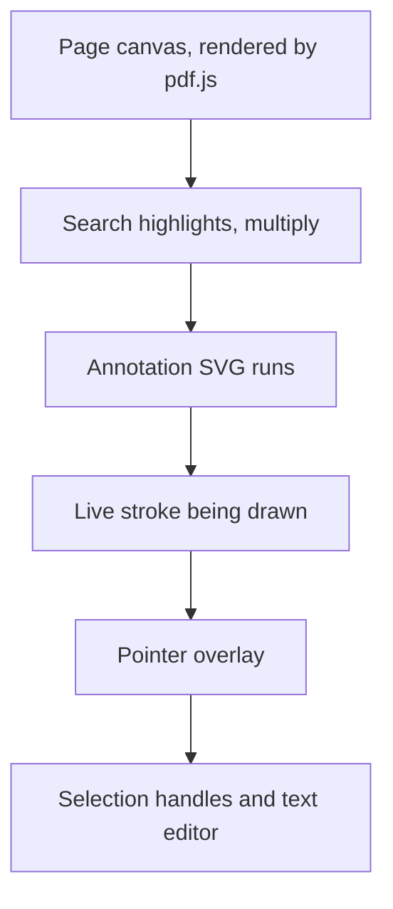
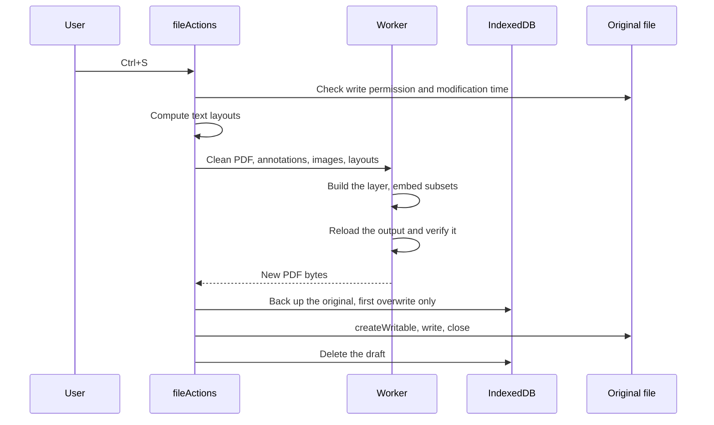

# Architecture

Vetro PDF is a client-only application. It has no backend, so everything that a server would normally do, such as parsing, persistence and recovery, happens in the browser. This document explains how the code is organised and why.

## Layers

| Layer | Location | Responsibility | Depends on |
| --- | --- | --- | --- |
| Model | `src/model` | Annotation types, geometry, vector paths, text layout, font catalogue | Nothing from the app |
| State | `src/store` | Document content, history, selection, UI preferences, search | Model |
| PDF session | `src/pdf` | pdf.js document, render queue, thumbnails, page text | Model |
| Export | `src/export` | Reading and writing PDFs inside a Web Worker | Model |
| Storage | `src/storage` | IndexedDB access for recents, drafts and backups | Model |
| Actions | `src/actions` | Use cases: open, save, restore, clipboard, image insertion | All of the above |
| Tools | `src/tools` | Pointer gestures, keyboard shortcuts, text snapping | State, Model |
| Components | `src/components` | React interface | All of the above |

The model has no dependency on React or on the DOM, with one deliberate exception: text measurement in `textLayout.ts` uses a canvas. This keeps geometry and path generation usable from both the main thread and the worker.

## The annotation model

All coordinates are in PDF points in the page's **visual space**: origin at the top left, y pointing down, page rotation already applied. They do not depend on zoom.

```ts
type Annotation = InkAnnotation | ShapeAnnotation | TextAnnotation | ImageAnnotation;
```

| Kind | Stores |
| --- | --- |
| `ink` | Raw input as flat `x, y, pressure` triples, plus colour and width |
| `shape` | Two end points, for line, arrow, rectangle, ellipse and underline |
| `text` | Box, content and style, applied to the whole box |
| `image` | Box, rotation and a reference to a shared image asset |

Ink keeps the raw samples rather than the outline, because the outline can always be regenerated. Image bytes live outside the store, keyed by a content hash, so pasting the same screenshot twice stores it once.

## State and history

`docStore` holds annotations per page. Updates are immutable, so history is a list of snapshots that share all unchanged structure. This makes undo unlimited at a low memory cost, and it lets React skip every annotation that did not change.

Continuous gestures use a small transaction API:

```ts
beginTx();                 // remember the current snapshot
patch(...);                // apply live changes, no history entry
endTx();                   // one undo step for the whole gesture
```

A drag, a text-editing session and a slider movement each produce a single undo step. The dirty indicator compares revision numbers, so undoing back to the saved state correctly shows the document as clean.

## Rendering

A page is a stack of independent layers:



**Page canvas.** Pages render through a queue that allows two concurrent jobs and prioritises the pages closest to the viewport. An LRU cache keeps recent canvases so scrolling back is instant. During zoom the existing canvas is scaled with CSS, and a sharper one replaces it when the gesture settles. Canvas size is capped at 16 megapixels.

**Virtualisation.** Page heights are read once when the document opens, and their cumulative offsets allow a binary search for the visible range. Only the pages near the viewport exist in the DOM. Thumbnails use the same approach.

**Annotations.** Annotations are SVG, with a `viewBox` in PDF points. Zoom therefore needs no re-layout. Highlighter strokes need `mix-blend-mode: multiply`, which only works on the SVG root in relation to the canvas underneath. The list is split into runs of consecutive normal and multiply annotations, each with its own `<svg>`, which keeps the stacking order the user chose.

## One pipeline for screen and file

Divergence between what the editor shows and what is saved is the classic failure of annotation tools. Two rules prevent it:

1. **Paths have a single source.** `model/paths.ts` turns an annotation into segments, which become an SVG `d` attribute on screen and PDF operators on export. Quadratic curves are converted exactly into cubic Béziers, because PDF has no quadratic operator.
2. **Text is laid out once.** `model/textLayout.ts` computes line breaks, offsets and baselines. The SVG renderer and the exporter both draw from that result. Baselines follow the CSS inline box model, so the text does not jump when the editing textarea closes.

Ligatures and contextual alternates are disabled in both renderers so that they select the same glyphs. Kerning stays on: the exporter reads the pair adjustments from fontkit and writes them into a `TJ` array.

## Input

`usePagePointer` models each interaction as a gesture: ink, shape, erase, move or marquee. Pointer capture keeps a gesture alive outside the page, and coalesced events preserve fast stylus movement. Since a finger scrolls and a stylus draws, drawing and navigation coexist on touch screens.

## Saving



`createWritable` writes to a temporary file and replaces the target when closed, so a crash during a write leaves the original intact. Output that fails verification never reaches the disk.

Parsing and writing happen in a Web Worker, because `pdf-lib` works synchronously for long stretches on large files and would otherwise freeze the interface.

The on-disk format is described in [PDF-FORMAT.md](PDF-FORMAT.md).

## Failure handling

| Situation | Behaviour |
| --- | --- |
| Tab or browser crash | A draft is saved to IndexedDB every 3 seconds and offered on the next open |
| File changed by another program | Comparing modification times triggers a confirmation before overwriting |
| File locked by another program | Clear message suggesting Save As |
| Unwanted save | A backup of the original can be restored from the menu |
| Font lacks a character | Falls back to Inter, otherwise the app warns and writes `?` |
| No File System Access API | File input for opening and a download for saving |
| Page rewritten by another PDF tool | That page keeps its visible content, and the user is told it is no longer editable |

## Privacy and offline

A Content Security Policy in the production build restricts every resource to the application's own origin. Fonts, pdf.js character maps and WebAssembly decoders are bundled, and a Workbox service worker precaches them, so the app runs fully offline after the first visit.

## Testing

Tests run against the production build, so they exercise the real service worker and the Content Security Policy. Native file pickers cannot be automated, so tests replace them with handles from the Origin Private File System. These are genuine `FileSystemFileHandle` objects, which means the actual `createWritable` save path is exercised. Saved bytes are then inspected independently with `pdf-lib` and pdf.js in Node.
