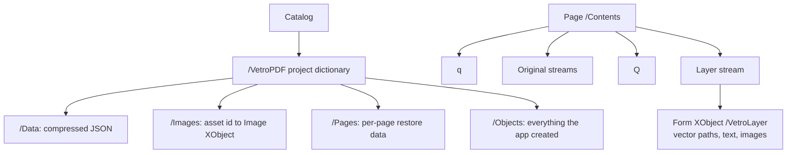
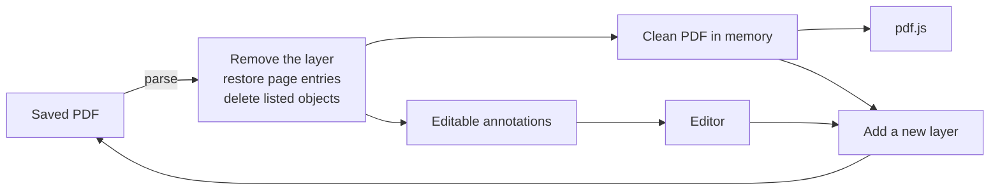

# PDF format

Vetro PDF has two conflicting goals. A saved file must look right in every PDF reader, which requires real page content. It must also reopen as editable objects, which requires structured data. The format serves both goals at once and keeps them separable.

## Structure of a saved file



### The visible layer

Each annotated page gets one Form XObject that draws its annotations with standard operators: vector paths, text in embedded font subsets, and image XObjects. Any conforming reader displays it, and no annotation-layer support is required.

The page's content array becomes:

```
[ q, ...original streams, Q, layer ]
```

Wrapping the original streams in `q` and `Q` matters. Many producers leave the graphics state altered at the end of a page, for example with a scaling matrix that would otherwise affect the layer.

Page resources are never edited in place, because several pages can share one dictionary. Annotated pages get a private shallow copy with the extra `/VetroLayer` entry.

### The project dictionary

A custom key in the document catalog holds everything needed to rebuild the editor state:

| Key | Purpose |
| --- | --- |
| `/DocId` | Stable identity of the document, used to find its drafts and backup |
| `/Data` | Flate-compressed JSON with annotations and margins |
| `/Images` | Maps each asset id to its image XObject |
| `/Pages` | One entry per modified page, with a reference to the page, its layer, and the original `/Resources`, `/MediaBox` and `/CropBox` |
| `/Wrap` | The shared `q` and `Q` streams |
| `/Objects` | References to every indirect object the app created |

Pages are linked by object reference rather than by index. If another tool reorders pages, the annotations follow them.

## Round trip



On open, the worker reads the project data and then removes its own traces: it takes the layer and wrapper streams out of `/Contents`, restores the page entries, and deletes every object listed in `/Objects`. The application then edits this clean document.

Every save begins from the clean document, not from the previous output. Nothing can accumulate, because each save has exactly one layer to write. The test suite confirms this by comparing object counts and file sizes across saves.

`/Objects` is computed rather than maintained by hand. Objects created during a save are identified by their object number, after font and image embedding have been flushed. This catches indirect dependencies such as font descriptors, CID fonts and `ToUnicode` maps. Because the entries are real references, they stay correct if another tool renumbers the file.

## Coordinate mapping

Annotations are stored in visual space. With `s` as the ratio between the page box and the visual width, the export matrix depends on the page rotation:

| `/Rotate` | Matrix `[a b c d e f]` |
| --- | --- |
| 0 | `[ s 0 0 -s x0 y1 ]` |
| 90 | `[ 0 s s 0 x0 y0 ]` |
| 180 | `[ -s 0 0 s x1 y0 ]` |
| 270 | `[ 0 -s -s 0 x1 y1 ]` |

The box is the intersection of CropBox and MediaBox, which is what viewers display. Computing `s` from the measured size also handles `UserUnit` without special cases.

The widened margin extends the box on whichever side is visually on the right, which depends on the rotation. Original boxes are stored in the project dictionary, so reopening restores the exact page geometry.

## Text

Text is drawn glyph by glyph in a `TJ` array, with kerning from fontkit. Subsetting keeps files small, and `ToUnicode` maps keep the text searchable and selectable in other readers.

Styles missing from a family are simulated: italics with a text matrix shear, bold with fill-and-stroke rendering. Characters absent from a font fall back to Inter within the same line.

### Font normalisation

fontkit's subsetter writes the short form of the `loca` table, which can only represent even offsets. Inter, Caveat and Patrick Hand contain odd-length glyphs, so their outlines shifted by one byte in the subset. Text extraction still worked, while glyphs silently disappeared in PDFium. `scripts/normalize-fonts.mjs` rewrites those fonts with padded glyphs, and a test asserts that every bundled font keeps even offsets. The other fonts were not affected and remain untouched.

## Images

Images are stored once, as ordinary image XObjects.

- **JPEG** data stays in its original DCT stream and is recovered byte for byte.
- **PNG** is stored as Flate-compressed RGB with an optional soft mask. On reopen, the pixels are rebuilt losslessly.
- **Other formats** such as WebP are converted to PNG on insertion.

## Interoperability

| Case | Behaviour |
| --- | --- |
| A tool keeps the structure | Annotations remain editable |
| A tool merges page content | The layer can no longer be separated, so that page's annotations stay visible as normal content and the user is told. Objects are retained so that the merged content keeps working |
| A tool drops the custom catalog key | The file is treated as a plain PDF with the drawing baked in |
| A tool deletes a page | Annotations for that page are dropped, and all others are unaffected |
| The PDF is encrypted | Opening is refused, because the file could not be rewritten correctly |

Interactive forms, links, bookmarks and other existing page annotations are preserved. Saving rewrites the file, so digital signatures do not remain valid.
